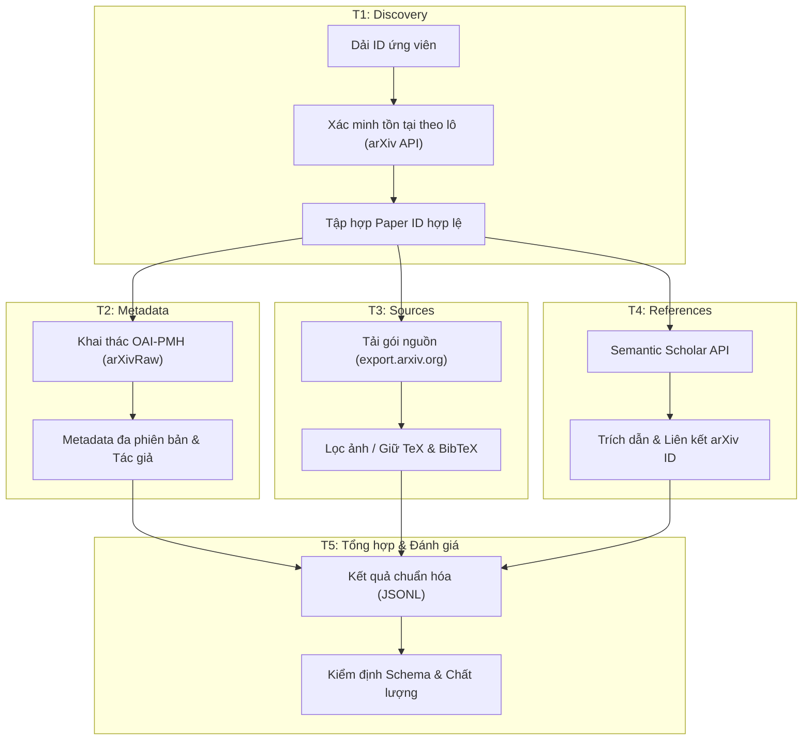

# 1.1 Tổng quan và kiến trúc pipeline

> **Người phụ trách:** Mẫn Nhi (`@NhiNgo49`)  
> **Reviewer:** Hoàng (`huynhhuyhoang2006@gmail.com`)

> [!NOTE]
> **Trang giữ chỗ (Placeholder):** Nội dung tiểu mục này đang được Mẫn Nhi biên soạn theo kế hoạch.

## 1. Mục tiêu Milestone 1
Mục tiêu của Milestone 1 là xây dựng một pipeline thu thập dữ liệu bài báo arXiv mạnh mẽ, có khả năng xử lý hàng chục nghìn bài báo với cấu trúc dữ liệu đa phiên bản, nguồn TeX/BibTeX đã được làm sạch và mạng lưới trích dẫn phong phú.

## 2. Sơ đồ Pipeline thu thập dữ liệu

## 3. Công nghệ và Thư viện
Hệ thống tuân thủ nghiêm ngặt nguyên tắc chỉ sử dụng **thư viện chuẩn** (`urllib.request`) để thực thi các kết nối HTTP, đảm bảo khả năng tương thích cao nhất và hạn chế phụ thuộc bên ngoài.
