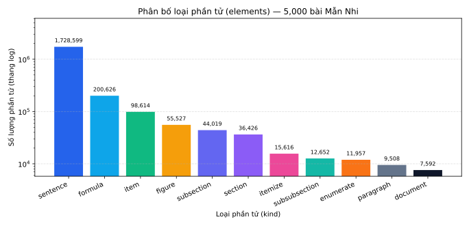
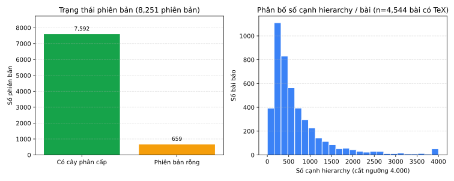

# 2.1 Phân tích cú pháp phân cấp

> **Người phụ trách:** Mẫn Nhi (`@NhiNgo49`)  
> **Reviewer:** Hoàng (`huynhhuyhoang2006@gmail.com`)

---

## 1. Mục tiêu và phạm vi

Mục tiêu của bước phân tích cú pháp phân cấp là chuyển đổi kho mã nguồn LaTeX của từng phiên bản bài báo (đầu ra Milestone 1) thành một cấu trúc cây phân cấp có kiểm chứng (`VersionHierarchy`). Quá trình này gồm hai công đoạn nối tiếp trong `arxiv_pipeline`:

1. **Tập hợp và giải quyết đường dẫn (`arxiv_pipeline.gathering`):** Xác định file gốc chứa `\documentclass`, mở rộng đệ quy các lệnh `\input`, `\include`, `\subfile` theo đúng thứ tự biên dịch, đồng thời ghi nhận các phiên bản không có mã nguồn TeX.
2. **Dựng cây phân cấp (`arxiv_pipeline.hierarchy`):** Quét luồng nội dung văn bản, dựng cây gồm nút gốc `document`, các nút vùng chứa (`section`, `subsection`, `subsubsection`, `paragraph`, `itemize`, `enumerate`, `item`) và các nút lá (`sentence`, `formula`, `figure`), loại trừ phần Tài liệu tham khảo nhưng giữ lại `Acknowledgements` và `Appendix`.

---

## 2. Xác định file gốc và hợp nhất nguồn TeX (`gathering`)

Một phiên bản bài báo trên arXiv thường chứa nhiều file `.tex` (chương, phụ lục, macro, hoặc bản nháp cũ). Module `arxiv_pipeline.gathering` thực hiện hợp nhất nguồn theo 3 bước:

### 2.1. Phân loại trạng thái nguồn (`SourceGatherer`)

`SourceTree` quét toàn bộ cây thư mục của phiên bản để liệt kê các file `.tex`, `.bib`, `.bbl`:
- Nếu không có file `.tex` nào (chỉ có PDF/DOCX), `SourceGatherer` trả về `status="empty_source"` với `merged_tex=""`. Phiên bản này không sinh nút nào nhưng vẫn được ghi nhận là **phiên bản rỗng** trong thống kê độ phủ.
- Nếu có `.tex` nhưng không có file nào chứa `\documentclass` hoặc `\documentstyle` (ngoài vùng comment), hệ thống trả về `status="no_root_file"`.

### 2.2. Xếp hạng ứng viên file gốc (`RootFinder`)

Để chọn đúng file LaTeX chính mà arXiv dùng để biên dịch, `RootFinder` quét tất cả file `.tex` trên bản sao đã che comment (`mask_comments`), tìm những file có `\documentclass` rồi sắp xếp theo khóa ưu tiên `RootCandidate.sort_key()`:

| Thứ tự ưu tiên | Tiêu chí | Ý nghĩa |
|---:|---|---|
| 1 | Không phải tệp tạm trình soạn thảo | Loại các tệp như `_region_.tex` (AUCTeX) |
| 2 | Có `\begin{document}` | Ưu tiên tài liệu hoàn chỉnh thay vì tệp cấu hình |
| 3 | Không phải lớp `standalone` / `subfiles` | Tránh chọn nhầm hình vẽ hoặc chương lẻ |
| 4 | Không bị tệp `.tex` khác `\input` / `\include` | File gốc là điểm vào cao nhất |
| 5 | Nằm ở thư mục gốc phiên bản | Tránh chọn bản sao trong thư mục con (`OldFiles/`, `doc/`) |
| 6 | Tên tệp phổ biến | Ưu tiên `main.tex`, `ms.tex`, `paper.tex`, `article.tex`, `manuscript.tex` |
| 7 | Độ dài sau khi mở rộng (`merged_chars`) | Chọn tệp biên dịch ra nội dung đầy đủ nhất |

### 2.3. Mở rộng đệ quy `\input` / `\include` (`IncludeExpander`)

Từ `root_file` được chọn, `IncludeExpander` duyệt và chèn nội dung các tệp được gọi qua `\input`, `\include`, `\subfile`:
- **Thứ tự tìm tệp:** Thư mục chứa `root_file` $\rightarrow$ thư mục chứa tệp đang gọi $\rightarrow$ thư mục gốc nguồn.
- **Xử lý lệnh đặc biệt:** Dừng đọc tệp tại `\endinput`; với `\subfile{x}`, chỉ trích phần thân giữa `\begin{document}` và `\end{document}` để bỏ preamble trùng; hỗ trợ mở rộng macro đường dẫn đơn giản từ `\newcommand` và `\def`.
- **Chống lặp vô hạn:** Giới hạn độ sâu đệ quy `DEFAULT_MAX_DEPTH = 64`. Nếu tệp đích đã nằm trên ngăn xếp gọi hiện tại, hệ thống ghi nhận vào danh sách `cycles` và bỏ qua để tránh vòng lặp; các tệp không tìm thấy được ghi vào `missing`.

---

## 3. Dựng cây phân cấp tài liệu (`hierarchy`)

Sau khi có `GatheredSource` với `merged_tex`, `HierarchyBuilder` dựng cây `VersionHierarchy` theo luồng xử lý sau:

```{mermaid}
flowchart TD
    A["GatheredSource (merged_tex)"] --> B{"status == empty_source?"}
    B -->|Có| C["Trả về nodes = [] (phiên bản rỗng)"]
    B -->|Không| D["strip_comments + strip_comment_environments"]
    D --> E["extract_title + extract_document_body + clean_latex"]
    E --> F["Khởi tạo HierarchyStack (root: document, level 0)"]
    F --> G["Quét luồng bằng STREAM_DELIMITER_RE"]
    G --> H{"Loại delimiter?"}
    H -->|"section / subsection / ..."| I["Đóng stack có level >= mới, push_section"]
    H -->|"itemize / enumerate / item"| J["push_list_container / push_item / pop_list_container"]
    H -->|"thebibliography / References"| K["Bật cờ in_references (loại trừ nội dung)"]
    H -->|"block_math / figure / table"| L["Chuẩn hóa & add_leaf (formula / figure)"]
    H -->|"Văn xuôi (prose)"| M["process_prose_block -> add_leaf (sentence)"]
    I --> N["validate_version_hierarchy"]
    J --> N
    K --> N
    L --> N
    M --> N
    N --> O["VersionHierarchy"]
```

### 3.1. Tiền xử lý và lọc comment

Trước khi quét cấu trúc, `HierarchyBuilder.build_from_source` loại bỏ các chú thích LaTeX qua hai lớp:
- `strip_comments`: Xóa phần từ dấu `%` chưa escape (số lượng dấu `\` đứng trước là số chẵn) đến hết dòng, giữ nguyên `\%`.
- `strip_comment_environments`: Xóa toàn bộ vùng `\begin{comment}...\end{comment}`, nhưng **bảo toàn nguyên vẹn** nội dung bên trong `\begin{verbatim}`, `\begin{lstlisting}`, `\begin{minted}` và `\verb|...|`.

Tiếp theo, tiêu đề tài liệu được trích từ `\title[short]{long}` (`extract_title`), và phần thân văn bản được cắt từ `\begin{document}` đến `\end{document}` (`extract_document_body`) để tránh các khai báo macro ở preamble lọt vào cây nội dung.

### 3.2. Các loại nút và quy tắc ngăn xếp (`HierarchyStack`)

`HierarchyStack` duy trì ngăn xếp các vùng chứa đang mở để gán `parent_temp_id` cho mọi phần tử mới:

| Nhóm | Loại nút (`ElementKind`) | Mức (`level`) / Vai trò | Quy tắc xử lý |
|---|---|---|---|
| Gốc | `document` | `0` (gốc duy nhất) | Khởi tạo mặc định, `parent_temp_id = None` |
| Phân mục | `section` (gồm cả `chapter`), `subsection`, `subsubsection`, `paragraph` | `2` (hoặc `1` cho `chapter`), `3`, `4`, `5` | Khi mở mục mới ở mức $L$, tự động `pop` các mục/item có `level >= L` (dừng trước `document`) |
| Danh sách | `itemize`, `enumerate`, `item` | `parent_level + 10` và `+ 1` | `item` mới tự đóng `item` anh em trước đó; `\end{itemize}` / `\end{enumerate}` kiểm tra tồn tại trên stack trước khi `pop` |
| Nút lá | `sentence`, `formula`, `figure` | Nút tận cùng (không đẩy vào stack) | Gắn trực tiếp vào `current_parent_id` |

Ba loại nút lá được tạo bởi `leaf_parser`:
- **`sentence`:** Văn bản xuôi giữa các dấu phân cách cấu trúc được lọc nhãn/wrapper (`strip_prose_markup`), chuẩn hóa định dạng và tách câu bằng `process_prose_block`.
- **`formula`:** Các công thức khối (`equation`, `align`, `gather`, `multline`, `eqnarray`, `flalign`, `alignat`, `displaymath`, `\[...\]`, `$$...$$`) được đưa về dạng chuẩn `\begin{equation}...\end{equation}`.
- **`figure`:** Các môi trường `figure`, `table`, `wrapfigure`, `wraptable`, `tabular`, `longtable` (kể cả dạng có dấu `*`) được gộp chung vào `kind="figure"` sau khi làm sạch lệnh dàn trang.

### 3.3. Loại trừ Tài liệu tham khảo và giữ Phụ lục

`STREAM_DELIMITER_RE` nhận diện các khối tham khảo để loại trừ khỏi cây nội dung:
- Các môi trường `\begin{thebibliography}`, `bibdiv`, `biblist` và các lệnh `\bibliography`, `\bibliographystyle`, `\addbibresource`, `\printbibliography`, `\putbib`.
- Các mục `\section{...}` có tiêu đề sau chuẩn hóa thuộc `REFERENCE_TITLES` (`references`, `reference`, `bibliography`, `works cited`, `literature cited`) sẽ bật cờ `in_references = True` để bỏ qua nội dung bên trong.
- Khi gặp `\appendix` hoặc một `\section` thông thường mới, cờ `in_references` được tắt để **giữ lại đầy đủ** phần `Acknowledgements` và các phụ lục (`Appendix`).

---

## 4. Kiểm tra toàn vẹn cây (`validate_version_hierarchy`)

Mỗi `VersionHierarchy` sinh ra bắt buộc đi qua hàm `validate_version_hierarchy` với 6 ràng buộc:

1. Nếu `nodes` rỗng, cây được xem là hợp lệ cho phiên bản không có TeX (`empty_source`).
2. Nếu `nodes` không rỗng, phải có **đúng một** nút có `parent_temp_id = None` và `kind == "document"`.
3. Mọi `temp_id` trong cùng phiên bản phải không rỗng và duy nhất.
4. Mọi `kind` phải thuộc tập hợp `ElementKind` hợp lệ.
5. Mọi nút khác gốc phải có `parent_temp_id` trỏ tới một nút tồn tại trong cây.
6. Đồ thị cha–con không được chứa chu trình (kiểm tra bằng duyệt ngược tới gốc cho từng nút).

---

## 5. Kết quả thực nghiệm trên toàn bộ tập dữ liệu của Mẫn Nhi

Kết quả dưới đây được tổng hợp trực tiếp từ tệp `parsing.sqlite` chạy trên **toàn bộ 5.000 bài báo** thuộc dải phân công của Mẫn Nhi (`2501.12642` – `2501.17641`) trên Google Colab CPU (`is_mock = false`), xuất qua `data/mannhi/m2_hierarchy_summary.json` và `data/mannhi/m2_hierarchy_publications.csv`.

### 5.1. Tổng hợp độ phủ và quy mô cây phân cấp

| Chỉ số | Giá trị | Ghi chú |
|---|---:|---|
| Số bài báo (`publications_meta`) | 5.000 | Đủ 100% dải `2501.12642` – `2501.17641` |
| Tổng số phiên bản khai báo | 8.251 | 2.850 bài có 1 phiên bản; 2.150 bài có $\ge 2$ phiên bản |
| Phiên bản dựng được cây (`document`) | 7.592 | Chiếm **92,01%** tổng số phiên bản |
| Phiên bản rỗng (`empty_versions`) | 659 | Chiếm **7,99%**; thuộc 524 bài báo (456 bài rỗng toàn bộ phiên bản) |
| Phần tử trước khử trùng lặp (`raw_element_count`) | 3.294.738 | Tổng trên toàn bộ các phiên bản |
| Phần tử duy nhất sau gộp (`elements`) | 2.221.136 | Giảm **32,59%** nhờ khử trùng lặp giữa các phiên bản |
| Tổng số cạnh cha–con (`hierarchy`) | 3.269.197 | Trung bình **430,61 cạnh** / phiên bản có cây |

Chi tiết phân bố đầy đủ cả 11 loại phần tử (`ElementKind`) trong bảng `elements`:

| Loại phần tử (`kind`) | Số lượng | Tỷ lệ |
|---|---:|---:|
| `sentence` | 1.728.599 | 77,82% |
| `formula` | 200.626 | 9,03% |
| `item` | 98.614 | 4,44% |
| `figure` | 55.527 | 2,50% |
| `subsection` | 44.019 | 1,98% |
| `section` | 36.426 | 1,64% |
| `itemize` | 15.616 | 0,70% |
| `subsubsection` | 12.652 | 0,57% |
| `enumerate` | 11.957 | 0,54% |
| `paragraph` | 9.508 | 0,43% |
| `document` | 7.592 | 0,34% |

### 5.2. Ví dụ bản ghi thật từ bài `2501.12643`

Trích xuất trực tiếp một số nút đầu tiên của bài `2501.12643` trong `parsing.sqlite`:

| `element_id` | `kind` | Nội dung (`content`, rút gọn) |
|---|---|---|
| `2501.12643#root1` | `document` | `Tensor cross interpolation approach for quantum impurity problems based on the weak-coupling expansion` |
| `2501.12643#s1` | `sentence` | `We apply the tensor cross interpolation (TCI) algorithm to solve equilibrium quantum impurity problems with high precisi...` |
| `2501.12643#h1` | `section` | `Introduction` |
| `2501.12643#s7` | `sentence` | `Solving quantum impurity problems is a fundamental issue in condensed matter physics.` |

Các câu tóm tắt (`s1`–`s6`) được gắn trực tiếp dưới nút gốc `root1`, còn các câu trong phần thân (`s7`, `s8`, ...) nằm dưới mục `h1` (`Introduction`); các công thức khối (`2501.12643#eq1`, `eq2`, ...) được gắn tương ứng dưới từng mục (`h3`, `h6`, `h7`, `h8`).

### 5.3. Biểu đồ phân tích cấu trúc cây





---

## 6. Tài liệu tham khảo

- Đề bài Milestone 2: [Parsing Statement](https://hcmus-cs-ta.github.io/lab-book/intro-ds/statement/parsing)
- Mã nguồn `arxiv_pipeline.gathering` (`root_finder.py`, `expander.py`, `service.py`, `latex_scan.py`) và `arxiv_pipeline.hierarchy` (`builder.py`, `stack.py`, `leaf_parser.py`, `latex_utils.py`, `validation.py`).
