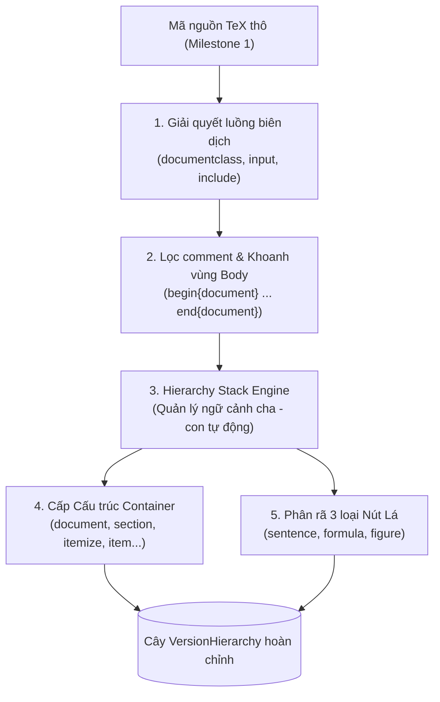
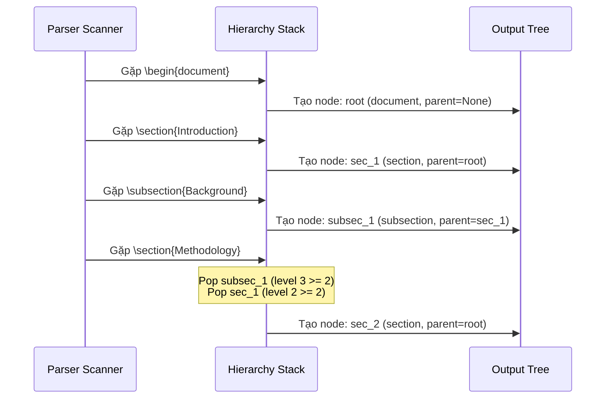
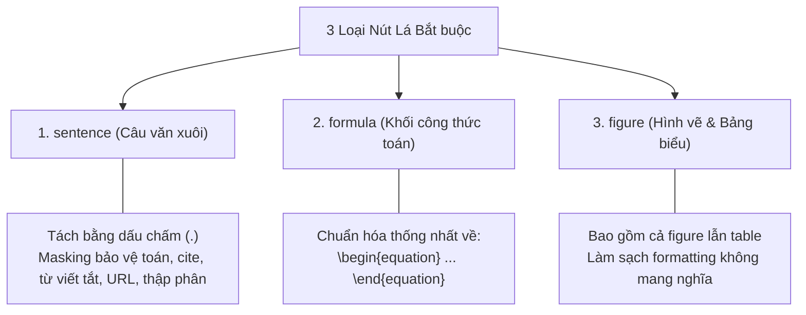

# 2.1 Phân tích cú pháp phân cấp (Hierarchical Parsing)

> **Người phụ trách:** Hoàng (`huynhhuyhoang2006@gmail.com`)  
> **Reviewer:** Trọng (`@phamminhtrong2306`), Mẫn Nhi (`@NhiNgo49`)

---

## 1. Mục tiêu & Vị trí trong Pipeline

Trong Milestone 2, mục tiêu cốt lõi của phân tích cú pháp phân cấp là chuyển đổi các tệp mã nguồn LaTeX thô thu thập từ Milestone 1 thành một cấu trúc cây có thứ tự và quan hệ cha–con tường minh cho từng phiên bản (`VersionHierarchy`). 

Cây phân cấp này đóng vai trò làm khung xương định hình nội dung, làm tiền đề cho quá trình chuẩn hóa ngữ nghĩa và khử trùng lặp toàn văn xuyên phiên bản (Cross-version Content Deduplication) ở các bước tiếp theo.

---

## 2. Giải quyết Đa tệp & Xác định Luồng Biên dịch (Multi-file Gathering)

Nội dung một bài báo khoa học trên arXiv thường được chia nhỏ ra nhiều tệp con (`.tex`) và nạp vào tệp chính thông qua các lệnh `\input{...}` hoặc `\include{...}`. Để đảm bảo dữ liệu phân tích phản ánh chính xác 100% những gì người đọc nhìn thấy trên bản PDF xuất bản:

1. **Định vị tệp gốc (Root File):** Tìm kiếm tệp chứa khai báo `\documentclass` hợp lệ (bỏ qua các dòng bị chú thích `% \documentclass`).
2. **Lần vết đệ quy (Transitive Traversal):** Duyệt theo cây phụ thuộc của các lệnh `\input` và `\include` theo đúng thứ tự xuất hiện.
3. **Loại bỏ nhiễu và tệp thừa (Garbage Filtering):** Bỏ qua hoàn toàn các lệnh `\input` nằm sau dấu comment `%`. Mọi tệp `.tex` không nằm trên đường dẫn biên dịch xuất phát từ root file đều được xem là tệp rác/tệp nháp và bị loại bỏ.
4. **Ghép chuỗi tuyến tính (Linear Stream Concatenation):** Nội dung các tệp con được nhúng trực tiếp vào vị trí gọi lệnh tương ứng, tạo thành một luồng văn bản TeX duy nhất trước khi đưa vào bộ phân tích cú pháp.

---

## 3. Thuật toán Ngăn xếp Phân cấp (Hierarchy Stack Engine)

Khác với các định dạng đánh dấu có thẻ đóng tường minh như XML hay HTML (`<section>...</section>`), LaTeX sử dụng các lệnh đánh dấu điểm bắt đầu (`\section{...}`, `\subsection{...}`) mà không có thẻ kết thúc. Để giải quyết bài toán xác định phạm vi (scope) và quan hệ cha–con một cách tất định, nhóm áp dụng **Thuật toán Ngăn xếp Phân cấp (Hierarchy Stack)**.

### A. Phân định Cấp bậc Số học (Hierarchy Depth Levels)

Mỗi loại thành phần cấu trúc được gán một cấp bậc số học cố định:

| Thành phần (`kind`) | Cấp bậc (`level`) | Mô tả & Vai trò |
|---|:---:|---|
| `document` | **0** | Nút gốc tối cao đại diện cho toàn bộ tài liệu (duy nhất 1 node/cây) |
| `chapter` / `section` | **2** | Cấp cấu trúc chính (chương hoặc mục lớn của bài báo) |
| `subsection` | **3** | Tiểu mục cấp 1 |
| `subsubsection` | **4** | Tiểu mục cấp 2 |
| `paragraph` | **5** | Đoạn văn có tiêu đề phân cấp |
| `itemize` / `enumerate` | **Parent + 10** | Khối danh sách liệt kê (vùng chứa container cấp cao) |
| `item` | **List + 1** | Điểm mục liệt kê bên trong danh sách |

### B. Cơ chế Tự động Đóng Cấp (Scope Unwinding)

Khi parser quét tới một lệnh phân cấp mới có cấp độ $L$:
1. Ngăn xếp tự động pop (loại bỏ) tất cả các khung phạm vi đang mở có cấp độ $\ge L$.
2. Nút trên đỉnh ngăn xếp sau khi pop chính là **nút cha trực tiếp** của phần tử mới.
3. Tạo nút mới, gán `parent_temp_id` trỏ về nút cha vừa xác định, rồi push nút mới vào đỉnh ngăn xếp.

> **Ví dụ về tính tất định:** Khi đang ở `paragraph` (level 5) thuộc `subsection` (level 3), nếu gặp một `\section` mới (level 2), ngăn xếp sẽ tự động pop `paragraph`, pop `subsubsection` (nếu có), pop `subsection`, và pop `section` cũ, đưa đỉnh ngăn xếp về lại nút `document` (level 0). Nút `section` mới được gắn làm con trực tiếp của `document`.

### C. Quy tắc Xử lý Danh sách Liệt kê (Lists & Items)

Theo yêu cầu đề bài:
* Môi trường `\begin{itemize}` hoặc `\begin{enumerate}` được định nghĩa là **thành phần cấp cao** (`higher component`).
* Mỗi điểm liệt kê `\item` là **thành phần cấp kế tiếp** (`next-level element`).
* **Quan hệ anh em (Siblings):** Khi một `\item` mới xuất hiện trong cùng danh sách, parser tự động pop `\item` trước đó. Do đó, các `\item` cùng cấp đều trỏ về cha chung là khối `itemize`/`enumerate`, không bị lồng sai lệch vào nhau.
* **Hỗ trợ lồng nhau đa tầng:** Nếu bên trong một `\item` có mở một danh sách con (`enumerate`), danh sách con này sẽ gắn làm con của `\item` đó, bảo toàn chính xác cấu trúc logic.

---

## 4. Đặc tả 3 Loại Nút Lá Bắt buộc (Leaf Granularity)

Đề bài tại `parsing.md` quy định nghiêm ngặt: **Nút lá (nhỏ nhất) của cây phân cấp CHỈ ĐƯỢC PHÉP LÀ 3 LOẠI DUY NHẤT:**

### 1. `sentence` (Câu văn xuôi):
* Văn bản thân bài được phân tách thành từng câu đơn bằng dấu chấm câu `.`.
* **5 Ràng buộc cấm ngắt câu (Negative Constraints):** Tuyệt đối không được tách câu nếu dấu chấm nằm trong:
  1. Công thức toán học nội dòng (`$ ... $`).
  2. Lệnh LaTeX (`\cite{...}`, `\ref{...}`).
  3. Từ viết tắt học thuật (`i.e.`, `e.g.`, `et al.`, `Fig. 1`, `Eq. 2`, `Dr.`, `Prof.`, `vs.`, `cf.`, `vol.`, `no.`, `sec.`, `approx.`, `viz.`, `al.`).
  4. Số thập phân (`3.14`, `0.001`).
  5. Địa chỉ URL hoặc email (`https://...`, `user@domain.com`).
* **Giải pháp kỹ thuật:** Sử dụng kỹ thuật **Masking đa tầng** bằng placeholder trước khi tách câu và phục hồi nguyên vẹn sau khi phân tách, loại trừ khả năng bẻ vụn câu học thuật.

### 2. `formula` (Khối công thức toán học):
* Bóc tách toàn vẹn các khối toán độc lập (`\begin{equation}...\end{equation}`, `$$...$$`, `\[...\]`, `align`, `gather`).
* Chuẩn hóa toàn bộ về định dạng thống nhất duy nhất: `\begin{equation} ... \end{equation}`.

### 3. `figure` (Hình ảnh và Bảng biểu):
* Đề bài ghi rõ: *"with Tables also considered a type of Figure for this purpose"*.
* Toàn bộ môi trường `\begin{figure}...\end{figure}` lẫn `\begin{table}...\end{table}` đều được gán nhãn `kind="figure"`.
* Loại bỏ các lệnh định dạng thừa không mang ngữ nghĩa (`\centering`, `[htpb]`, `\midrule`, `\toprule`, `\bottomrule`) nhưng giữ lại trọn vẹn `\caption`.

---

## 5. Quy tắc Loại trừ & Bao gồm (Exclusions & Inclusions)

* **LOẠI TRỪ TUYỆT ĐỐI (Exclusions):**
  * Danh mục tài liệu tham khảo: `\bibliography{...}`, `\begin{thebibliography}...\end{thebibliography}`, `\section{References}`, `\section*{Bibliography}`.
  * Toàn bộ phần này được loại khỏi cây phân cấp để nhường quyền bóc tách cho Module trích xuất BibTeX độc lập.
* **BAO GỒM BẮT BUỘC (Inclusions):**
  * Lời cảm ơn (`Acknowledgements`) và Phụ lục (`Appendix`, `Appendices`).
  * Được nhận diện chính xác kể cả dưới dạng unnumbered (`\section*{Acknowledgements}`, `\appendix \section{...}`) và đưa vào cây như một `section` chính quy.

---

## 6. Xử lý Trường hợp Ngoại lệ (Edge Cases)

1. **Phiên bản không có mã nguồn TeX (`empty_source` / PDF-only):**
   * Theo yêu cầu đề bài, các bài không có nguồn TeX từ Milestone 1 vẫn phải được ghi nhận bản ghi rỗng thay vì bỏ qua (`nodes = []`).
   * Điều này đảm bảo độ phủ phiên bản (version coverage) phản ánh đúng 100% thực tế của tập dữ liệu 25,000 bài báo.
2. **Văn bản mở đầu (Floating Preamble / Abstract):**
   * Đoạn văn tóm tắt hoặc nội dung nằm trước `\section` đầu tiên được tự động nhận diện và gắn trực tiếp làm con của nút gốc `document`.
