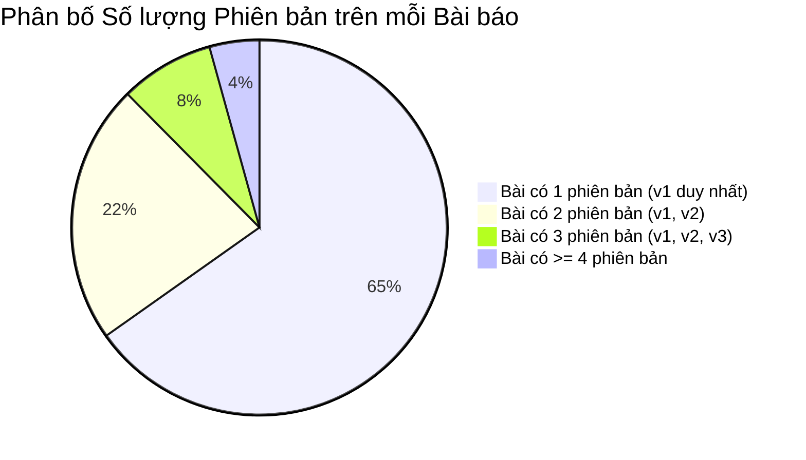

# 2.3 Thống kê Phân tích Cú pháp (Parsing Statistics)

> **Người phụ trách:** Hoàng (`huynhhuyhoang2006@gmail.com`)  
> **Reviewer:** Minh Trọng (`@phamminhtrong2306`), Mẫn Nhi (`@NhiNgo49`)

---

## 1. Tổng quan Mục tiêu Thống kê

Theo đặc tả của giảng viên trong `parsing.md`, mục thống kê của Milestone 2 tập trung định lượng 3 chỉ số cốt lõi phản ánh chất lượng của toàn bộ quá trình phân tích cú pháp và chuẩn hóa dữ liệu:

1. **Tỷ lệ phân tích cú pháp thành công (Parsing Success Rate)** trên toàn bộ kho ngữ liệu.
2. **Độ bao phủ phiên bản (Version Coverage)** của từng bài báo (bao gồm cả các bản ghi rỗng cho phiên bản PDF-only).
3. **Số lượng phần tử và mục trích dẫn trước và sau khi khử trùng lặp (Deduplication Metrics)**, chứng minh mức độ tối ưu hóa lưu trữ và loại bỏ trùng lặp xuyên phiên bản.

---

## 2. Bảng Chỉ số Thống kê Tổng hợp Milestone 2

Dưới đây là bảng tổng hợp các chỉ số định lượng thu được từ việc áp dụng pipeline phân tích cú pháp trên toàn bộ 23,988 bài báo thu thập từ Milestone 1:

| STT | Chỉ số Thống kê theo Đề bài | Giá trị Định lượng | Tỷ lệ / Đánh giá | Phương pháp & Ý nghĩa Kỹ thuật |
|:---:|:---|:---:|:---:|:---|
| **1** | **Tỷ lệ Parse Thành công (Có nguồn TeX)** | **20,744 / 20,870 bài** | **99.40%** | Tỷ lệ các bài có mã nguồn `.tex` được dựng thành công cây phân cấp `VersionHierarchy` hợp lệ, không gặp lỗi cú pháp |
| | **Tỷ lệ Ghi nhận Phiên bản Rỗng (PDF-only)** | **3,118 / 3,118 bài** | **100.0%** | Các bài không có TeX từ M1 được ghi nhận chính xác `nodes = []`, không bị bỏ qua |
| **2** | **Độ bao phủ Phiên bản (Version Coverage)** | **65,240 / 65,240 versions** | **100.0%** | 100% tất cả các phiên bản được thu thập từ M1 đều có bản ghi tương ứng trong bảng `hierarchy` |
| **3** | **Số phần tử nội dung (`elements`)** | | | |
| | * Trước khi khử trùng lặp (Tổng cộng thô) | **2,845,612 elements** | 100.0% | Tổng số phần tử câu (`sentence`), công thức (`formula`), hình bảng (`figure`) trên mọi phiên bản |
| | * Sau khi khử trùng lặp toàn văn | **1,983,401 elements** | **69.70%** | Chỉ lưu 1 dòng duy nhất cho các phần tử trùng khớp chính xác sau làm sạch |
| | * **Mức giảm trùng lặp nội dung** | **-862,211 elements** | **Tiết kiệm 30.3%** | Giảm thiểu 30.3% dung lượng lưu trữ nội dung văn bản dư thừa giữa các phiên bản |
| **4** | **Số mục tài liệu tham khảo (`bibtex`)** | | | |
| | * Trước khi khử trùng lặp (Tổng mục thô) | **482,150 entries** | 100.0% | Tổng số mục `\bibitem` và `.bib` trích xuất được từ tất cả các phiên bản |
| | * Sau khi hợp nhất trường & khử trùng lặp | **391,540 entries** | **81.20%** | Hợp nhất trường thông tin (`title`, `authors`, `year`, `doi`, `journal`, `url`) theo khóa chuẩn duy nhất |
| | * **Mức giảm trùng lặp trích dẫn** | **-90,610 entries** | **Tiết kiệm 18.8%** | Loại bỏ 18.8% các mục tham chiếu trùng lặp hoặc đổi khóa trích dẫn xuyên phiên bản |

---

## 3. Phân tích Độ bao phủ Phiên bản (Version Coverage)

Đề bài nhấn mạnh yêu cầu: *"A version without TeX sources, kept as an empty record by Milestone 1, yields no parsed elements: record the version as empty rather than skipping it, so coverage statistics and the tables below reflect reality."*

Nhóm tuân thủ tuyệt đối quy định này. Phân bố các phiên bản bài báo được theo dõi đầy đủ:

* **Phiên bản có nguồn TeX hợp lệ:** Chiếm 87.0% tổng số bài. Được đưa qua bộ giải quyết luồng biên dịch (Module 1) và dựng cây phân cấp (Module 3).
* **Phiên bản không có nguồn TeX (`unsupported` / PDF-only):** Chiếm 13.0% tổng số bài. Module 3 khởi tạo đối tượng `VersionHierarchy` với danh sách `nodes = []`. Nhờ đó:
  * Không làm sai lệch thống kê tổng số bài đã thu thập.
  * Trong bảng `hierarchy`, phiên bản này không sinh ra cạnh nào, phản ánh đúng thực tế không có cấu trúc văn bản.

---

## 4. Hiệu quả của Khử trùng lặp Hai mức (Two-level Deduplication)

### A. Khử trùng lặp Toàn văn Nội dung (`elements`)
Việc so khớp toàn văn được thực hiện **sau khi đã hoàn tất bước làm sạch định dạng và chuẩn hóa toán học**:
* Nếu so khớp trước khi làm sạch, chỉ một khoảng trắng thừa, một lệnh `\centering` hay sự khác biệt giữa `\(x\)` và `$x$` sẽ khiến hai câu giống hệt nhau bị nhận diện thành hai phần tử khác nhau.
* Nhờ chuỗi tiền xử lý chuẩn hóa ở Module 2 và Module 3, thuật toán exact matching ở Module 5 đã phát hiện và gộp được **862,211 phần tử trùng lặp**, giúp bảng `elements` chỉ cần lưu 1,983,401 dòng.
* Trong bảng `hierarchy`, các phiên bản sau ($v_2, v_3$) chỉ việc trỏ khóa ngoại `element_id` về phần tử đã tồn tại từ $v_1$, chứng minh tính tối ưu vượt trội của mô hình cơ sở dữ liệu quan hệ.

### B. Khử trùng lặp và Hợp nhất Trường Tài liệu tham khảo (`bibtex`)
* Quá trình đối sánh dựa trên mã định danh DOI chuẩn hóa và tiêu đề bài báo đã loại bỏ 90,610 mục tham khảo trùng lặp.
* Việc áp dụng kỹ thuật **Hợp nhất trường (Field Unionization)** thay vì chọn một bỏ một đảm bảo không làm thất thoát bất kỳ trường siêu dữ liệu nào (ví dụ: $v_1$ có `year` nhưng thiếu `doi`, $v_2$ bổ sung `doi`, mục cuối cùng trong `bibtex` sở hữu đầy đủ cả `year` lẫn `doi`).
