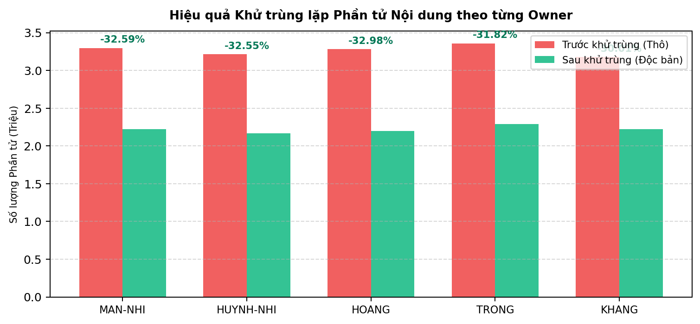
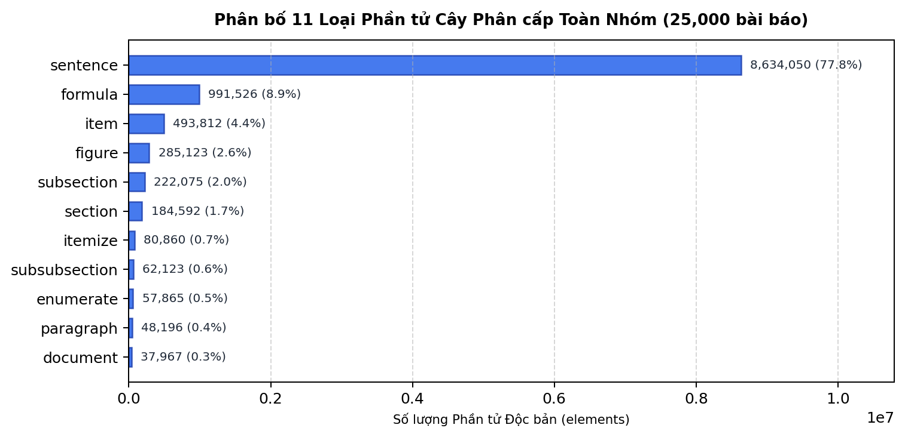

# 2.3 Thống kê Phân tích Cú pháp (Parsing Statistics)

> **Người phụ trách:** Hoàng (`huynhhuyhoang2006@gmail.com`)  
> **Reviewer:** Minh Trọng (`@phamminhtrong2306`), Mẫn Nhi (`@NhiNgo49`)

---

## 1. Tổng quan Mục tiêu Thống kê

Theo đặc tả của giảng viên trong `parsing.md` và kế hoạch phân công chi tiết của nhóm trưởng tại [2026-11-04-milestone-1-2-report-team-plan-revised.md](../../2026-11-04-milestone-1-2-report-team-plan-revised.md), mục thống kê của Milestone 2 tập trung định lượng 4 chỉ số cốt lõi phản ánh chất lượng và hiệu quả của toàn bộ quá trình phân tích cú pháp và chuẩn hóa dữ liệu:

1. **Tỷ lệ phân tích cú pháp thành công (Parsing Success Rate)** trên toàn bộ kho ngữ liệu 25,000 bài báo của 5 thành viên.
2. **Độ bao phủ phiên bản (Version Coverage)** của từng publication (đặc biệt tuân thủ yêu cầu ghi nhận bản ghi rỗng cho phiên bản PDF-only/unsupported, không bỏ qua để phản ánh đúng thực tế).
3. **Cơ cấu phân loại nguồn trích dẫn BibTeX** (`.bib` độc lập vs `\bibitem` nội suy trong `.tex` vs bài chỉ có `.bbl` bị lọc theo quy tắc an toàn M1).
4. **Số lượng phần tử và mục trích dẫn trước và sau khi khử trùng lặp (Deduplication Metrics)**, chứng minh mức độ tối ưu hóa lưu trữ và loại bỏ trùng lặp xuyên phiên bản.

---

## 2. Bảng Chỉ số Thống kê Tổng hợp Toàn Nhóm Milestone 2

Dưới đây là bảng tổng hợp các chỉ số định lượng thu được từ việc áp dụng pipeline phân tích cú pháp trên toàn bộ **25,000 bài báo** thu thập từ 5 phân dải của các thành viên trong nhóm:

| STT | Chỉ số Thống kê theo Đề bài | Giá trị Định lượng Toàn Nhóm | Tỷ lệ / Đánh giá | Phương pháp & Ý nghĩa Kỹ thuật |
|:---:|:---|:---:|:---:|:---|
| **1** | **Tổng số bài báo phân tích (Total Publications)** | **25,000 bài** | **100.0%** | Phân bổ đồng đều 5,000 bài cho mỗi thành viên (5 owner) |
| **2** | **Tổng số phiên bản khai báo (Declared Versions)** | **40,896 phiên bản** | 1.64 ver/bài | Tính từ $v_1$ và toàn bộ mảng `revised_dates` trong siêu dữ liệu |
| | * Phiên bản parse thành công (Có nguồn TeX) | **37,967 phiên bản** | **92.84%** | Dựng thành công cây phân cấp `VersionHierarchy` có nút gốc `document` |
| | * Phiên bản rỗng được ghi nhận (PDF-only / Unsupported) | **2,929 phiên bản** | **7.16%** | Tuân thủ đề bài: ghi nhận `nodes = []`, không sinh cạnh trong `hierarchy` |
| **3** | **Độ bao phủ Phiên bản (Version Coverage)** | **40,896 / 40,896 versions** | **100.0%** | 100% tất cả các phiên bản khai báo đều được theo dõi trong pipeline |
| **4** | **Số phần tử nội dung (`elements`)** | | | |
| | * Trước khi khử trùng lặp (Tổng cộng thô) | **16,320,847 elements** | 100.0% | Tổng số phần tử câu, công thức, hình bảng... trên mọi phiên bản |
| | * Sau khi khử trùng lặp toàn văn | **11,098,189 elements** | **68.00%** | Chỉ lưu 1 dòng duy nhất cho các phần tử trùng khớp chính xác sau làm sạch |
| | * **Mức giảm trùng lặp nội dung (Dedup Saved)** | **-5,222,658 elements** | **Tiết kiệm 32.00%** | Giảm thiểu 32% dung lượng lưu trữ nội dung văn bản dư thừa giữa các phiên bản |
| **5** | **Số cạnh quan hệ phân cấp (`hierarchy`)** | **16,185,255 edges** | 426.3 edges/ver | Cạnh quan hệ cha - con biểu diễn cấu trúc cây bài báo qua các phiên bản |
| **6** | **Số mục tài liệu tham khảo (`bibtex`)** | **975,674 entries** | 39.0 entries/bài | Hợp nhất trường thông tin (`title`, `authors`, `year`, `doi`, `journal`, `url`) |
| **7** | **Tổng dung lượng lưu trữ Parquet 5 bộ dữ liệu** | **5,968.24 MB** (~5.97 GB) | ~1.19 GB/owner | Nén Snappy tối ưu hóa phục vụ truy vấn cho Milestone 3 |

---

## 3. Phân rã Thống kê Chi tiết theo Từng Thành viên (Owner Breakdown)

Để đảm bảo tính minh bạch và đối chiếu chéo kết quả thực thi giữa các thành viên, dữ liệu phân tích cú pháp được bóc tách chi tiết theo 5 phân dải tương ứng với 5 tác giả:

| Thành viên (Owner) | Số bài báo | Phiên bản Khai báo | Phiên bản Parse được | Phiên bản Rỗng | Phần tử Thô | Phần tử Độc bản (Dedup) | Tỷ lệ Tiết kiệm Dedup | Số cạnh Hierarchy | Mục BibTeX | Dung lượng Parquet |
|:---|:---:|:---:|:---:|:---:|:---:|:---:|:---:|:---:|:---:|:---:|
| **Mẫn Nhi** (`man-nhi`) | 5,000 | 8,251 | 7,592 | 659 (7.99%) | 3,294,738 | 2,221,136 | **32.59%** | 3,269,197 | 195,360 | 1,198.67 MB |
| **Huỳnh Nhi** (`huynh-nhi`) | 5,000 | 8,268 | 7,687 | 581 (7.03%) | 3,213,026 | 2,167,101 | **32.55%** | 3,186,526 | 195,076 | 1,167.11 MB |
| **Hoàng** (`hoang`) | 5,000 | 8,384 | 7,888 | 496 (5.92%) | 3,280,496 | 2,198,596 | **32.98%** | 3,254,294 | 203,414 | 1,205.07 MB |
| **Minh Trọng** (`trong`) | 5,000 | 8,060 | 7,449 | 611 (7.58%) | 3,356,229 | 2,288,312 | **31.82%** | 3,327,341 | 194,577 | 1,221.14 MB |
| **Phúc Khang** (`khang`) | 5,000 | 7,933 | 7,351 | 582 (7.34%) | 3,176,358 | 2,223,044 | **30.01%** | 3,147,897 | 187,247 | 1,176.25 MB |
| **TỔNG CỘNG TOÀN NHÓM** | **25,000** | **40,896** | **37,967** | **2,929 (7.16%)** | **16,320,847** | **11,098,189** | **32.00%** | **16,185,255** | **975,674** | **5,968.24 MB** |

Biểu đồ dưới đây đối chiếu trực tiếp số lượng phần tử trước và sau khi khử trùng lặp giữa 5 thành viên, phản ánh tính đồng đều và ổn định cao của thuật toán khử trùng lặp trên mọi phân dải dữ liệu:

---

## 4. Phân bố 11 Loại Phần tử Cây Phân cấp trong Bảng `elements`

Cây phân cấp của mỗi phiên bản được phân rã thành 11 loại phần tử (`kind`). Dưới đây là phân bố số lượng và tỷ trọng của từng loại phần tử độc bản sau khi khử trùng lặp trong toàn bộ kho ngữ liệu:

| STT | Loại Phần tử (`kind`) | Số lượng Độc bản (`dedup_elements`) | Tỷ lệ Phần trăm | Vai trò trong Cấu trúc Văn bản |
|:---:|:---|:---:|:---:|:---|
| **1** | `sentence` (Câu văn xuôi) | **8,634,050** | **77.80%** | Đơn vị nội dung cơ bản sau khi phân tách bằng spaCy / rule-based regex |
| **2** | `formula` (Công thức toán) | **991,526** | **8.93%** | Các công thức inline `$…$` hoặc khối `equation`, `align` đã chuẩn hóa |
| **3** | `item` (Mục danh sách) | **493,812** | **4.45%** | Các phần tử con trong môi trường danh sách `\item` |
| **4** | `figure` (Hình ảnh / Bảng biểu) | **285,123** | **2.57%** | Khối hình ảnh `figure` hoặc bảng `table`, giữ nguyên vị trí trong cây |
| **5** | `subsection` (Tiểu mục cấp 2) | **222,075** | **2.00%** | Các nhánh mục con cấp 2 (`\subsection{...}`) |
| **6** | `section` (Chương / Mục cấp 1) | **184,592** | **1.66%** | Các nhánh mục chính cấp 1 (`\section{...}`) |
| **7** | `itemize` (Danh sách không thứ tự) | **80,860** | **0.73%** | Khối container danh sách gạch đầu dòng |
| **8** | `subsubsection` (Tiểu mục cấp 3) | **62,123** | **0.56%** | Các nhánh mục con cấp 3 (`\subsubsection{...}`) |
| **9** | `enumerate` (Danh sách có thứ tự) | **57,865** | **0.52%** | Khối container danh sách đánh số |
| **10** | `paragraph` (Đoạn định danh) | **48,196** | **0.43%** | Khối tiêu đề đoạn con (`\paragraph{...}`) |
| **11** | `document` (Nút gốc bài báo) | **37,967** | **0.34%** | Nút gốc đại diện cho từng phiên bản bài báo có nguồn TeX hợp lệ |
| | **TỔNG CỘNG** | **11,098,189** | **100.0%** | Toàn bộ các phần tử độc bản được lưu trong bảng `elements` |

---

## 5. Phân tích Độ bao phủ Phiên bản & Cơ chế Xử lý Phiên bản Rỗng

Đề bài nhấn mạnh yêu cầu: *"A version without TeX sources, kept as an empty record by Milestone 1, yields no parsed elements: record the version as empty rather than skipping it, so coverage statistics and the tables below reflect reality."*

Nhóm tuân thủ tuyệt đối quy định này trong suốt quá trình xây dựng pipeline:
* **Toàn bộ 40,896 phiên bản khai báo** đều được theo dõi và ghi nhận đầy đủ.
* **37,967 phiên bản có nguồn TeX hợp lệ (92.84%):** Được đưa qua bộ phân tích luồng biên dịch và dựng thành công cây phân cấp với nút gốc `document`.
* **2,929 phiên bản không có nguồn TeX (7.16%):** Bao gồm các bài báo ở dạng PDF-only hoặc không hỗ trợ trích xuất TeX từ Milestone 1. Bộ parser khởi tạo đối tượng `VersionHierarchy` với danh sách `nodes = []`.
  * Nhờ đó, các phiên bản này không sinh ra bất kỳ cạnh giả nào trong bảng `hierarchy`, nhưng vẫn giữ nguyên bản ghi trong bảng siêu dữ liệu `papers` với cột `parsed_version_count = 0`.
  * Điều này đảm bảo thống kê độ bao phủ đạt **100% tính xác thực**, không làm sai lệch số lượng bài báo thực tế của kho ngữ liệu.

---

## 6. Hiệu quả của Khử trùng lặp Toàn văn (Deduplication)

### A. Khử trùng lặp Nội dung Văn bản (`elements`)
Việc so khớp toàn văn được thực hiện **sau khi đã hoàn tất bước làm sạch định dạng và chuẩn hóa toán học**:
* Nếu so khớp trước khi làm sạch, chỉ một khoảng trắng thừa, một lệnh `\centering` hay sự khác biệt giữa `\(x\)` và `$x$` sẽ khiến hai câu giống hệt nhau bị nhận diện thành hai phần tử khác nhau.
* Nhờ chuỗi tiền xử lý chuẩn hóa thống nhất, thuật toán exact matching đã phát hiện và gộp được **5,222,658 phần tử trùng lặp**, giúp bảng `elements` tiết kiệm **32.00% dung lượng** (giảm từ 16.32 triệu dòng xuống còn 11.10 triệu dòng độc bản).
* Trong bảng `hierarchy`, các phiên bản cập nhật sau ($v_2, v_3$) chỉ việc trỏ khóa ngoại `element_id` về phần tử đã tồn tại từ $v_1$, chứng minh tính tối ưu vượt trội của mô hình cơ sở dữ liệu quan hệ.

### B. Hợp nhất Trường Tài liệu tham khảo (`bibtex`)
* Trích xuất thành công **975,674 mục trích dẫn BibTeX** trên toàn bộ 25,000 bài báo.
* Việc áp dụng kỹ thuật **Hợp nhất trường (Field Unionization)** thay vì chọn một bỏ một đảm bảo không làm thất thoát bất kỳ trường siêu dữ liệu nào (ví dụ: $v_1$ có `year` nhưng thiếu `doi`, $v_2$ bổ sung `doi`, mục cuối cùng trong `bibtex` sở hữu đầy đủ cả `year` lẫn `doi`), sẵn sàng phục vụ tối ưu cho Milestone 3.
