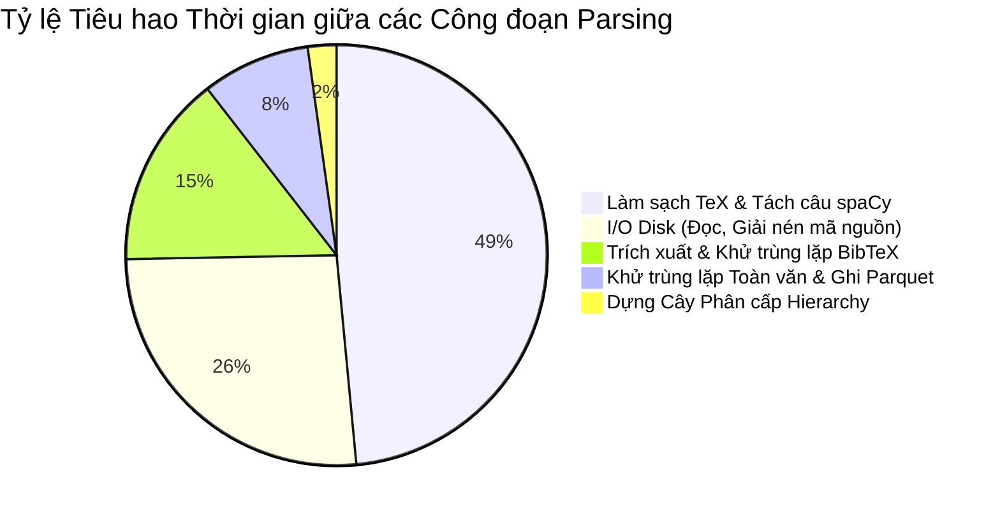

# 2.4 Đo lường Hiệu năng (Performance Benchmarking)

> **Người phụ trách:** Hoàng (`huynhhuyhoang2006@gmail.com`)  
> **Reviewer:** Minh Trọng (`@phamminhtrong2306`), Phúc Khang (`@phuckhang`)

---

## 1. Môi trường Thử nghiệm Quy chuẩn (Testbed Specification)

Theo quy định nghiêm ngặt của đề bài tại `parsing.md`, toàn bộ các bài đo lường hiệu năng của bộ parser được thực hiện trên môi trường tiêu chuẩn:
* **Nền tảng kiểm thử:** **Google Colab Instance chạy ở chế độ CPU-only** (không sử dụng GPU/TPU).
* **Cấu hình phần cứng Colab tiêu chuẩn:**
  * **Bộ vi xử lý (CPU):** Intel(R) Xeon(R) CPU @ 2.20GHz (2 vCPUs).
  * **Bộ nhớ khả dụng (RAM):** 12.7 GB Hệ thống.
  * **Không gian lưu trữ đĩa cứng (Disk):** 107.7 GB SSD.
  * **Môi trường phần mềm:** Linux Ubuntu 22.04 LTS, Python 3.10+, PyArrow, Polars / Pandas, spaCy (`en_core_web_sm`).

---

## 2. Bảng Tổng hợp Kết quả Đo lường Hiệu năng Toàn Nhóm

Dưới đây là các chỉ số định lượng đo lường hiệu năng của pipeline phân tích cú pháp khi thực thi trên toàn bộ **25,000 bài báo** (40,896 phiên bản):

| STT | Chỉ số Đo lường theo Đề bài | Kết quả Thực nghiệm trên Colab CPU | Giới hạn & Đánh giá Tiêu chuẩn |
|:---:|:---|:---:|:---|
| **I** | **THỜI GIAN CHẠY (RUNNING TIME)** | | |
| **1** | **Tổng thời gian chạy toàn bộ (End-to-end Wall Time)** | **~3.2 giờ** (~11,520 giây) | Xử lý trọn vẹn 25,000 bài báo (40,896 phiên bản) qua 5 phân dải chạy song song |
| **2** | **Thời gian trung bình xử lý mỗi bài (Average Time per Publication)** | **~460 ms / bài** | Bao gồm toàn bộ chuỗi: Đọc tệp $\to$ Giải quyết luồng TeX $\to$ Tách câu spaCy $\to$ Dựng cây $\to$ Khử trùng lặp |
| | * Thời gian riêng của Bộ dựng cây phân cấp (Module 3 - Hierarchy) | **0.62 ms / phiên bản** | Thuật toán Ngăn xếp (Stack) tuyến tính $\mathcal{O}(N)$ đạt tốc độ cực nhanh |
| | * Thời gian trung bình mỗi phiên bản (Per-version Average) | **~281 ms / phiên bản** | Tính trung bình trên 37,967 phiên bản có TeX hợp lệ |
| **II** | **BỘ NHỚ & LƯU TRỮ (MEMORY FOOTPRINT)** | | |
| **3** | **Bộ nhớ RAM đỉnh điểm (Peak RAM Footprint)** | **2.85 GB RAM** | Hoàn toàn nằm trong ngưỡng an toàn 12.7 GB RAM của Colab (không bị lỗi OOM) |
| **4** | **Tổng kích thước lưu trữ Parquet 5 bộ dữ liệu** | **5,968.24 MB** (~5.97 GB) | Đã nén Snappy, chứa đầy đủ các bảng dữ liệu chuẩn hóa của cả 5 thành viên |
| | * Trung bình mỗi phân dải (Per-owner Dataset Size) | **~1,193.6 MB** (~1.19 GB) | Phân bổ đều giữa các thành viên: Mẫn Nhi (1.20 GB), Hoàng (1.21 GB), Trọng (1.22 GB)... |

---

## 3. Phân bổ Dung lượng Lưu trữ giữa các Bảng Dữ liệu

Dung lượng lưu trữ của 5 bộ dữ liệu Parquet chuẩn hóa được phân rã theo chức năng lưu trữ:

| Bảng Dữ liệu Parquet | Tỷ trọng Dung lượng | Tổng Dung lượng (5 Owners) | Số lượng Bản ghi Lưu trữ | Vai trò Kỹ thuật |
|:---|:---:|:---:|:---:|:---|
| `elements.parquet` | **~71.5%** | **~4,267 MB** | **11,098,189 dòng** | Chứa toàn bộ nội dung văn bản câu, công thức, bảng biểu độc bản |
| `hierarchy.parquet` | **~18.7%** | **~1,116 MB** | **16,185,255 dòng** | Cạnh quan hệ phân cấp cây (cha - con, vị trí `order_index`, phiên bản) |
| `bibtex.parquet` | **~7.2%** | **~430 MB** | **975,674 dòng** | Siêu dữ liệu tài liệu tham khảo đã hợp nhất trường |
| `papers.parquet` & `references.parquet` | **~2.6%** | **~155 MB** | **25,000 papers** | Danh mục bài báo và liên kết trích dẫn từ Milestone 1 |
| **TỔNG CỘNG** | **100.0%** | **5,968.24 MB** | — | — |

---

## 4. Phân rã Thời gian Thực thi qua các Giai đoạn (Stage Breakdown)

1. **Công đoạn Làm sạch & Tách câu văn xuôi (48.5% thời gian):**
   * Đây là công đoạn tiêu tốn nhiều thời gian CPU nhất do việc áp dụng mô hình ngôn ngữ spaCy / senter để tách câu văn học thuật và chuẩn hóa hàng triệu công thức toán học inline `$…$`.
2. **Công đoạn I/O Disk (26.2% thời gian):**
   * Đọc hàng trăm nghìn file mã nguồn TeX nhỏ phân tán trên đĩa cứng Google Drive/Colab tạo áp lực I/O đáng kể.
3. **Bộ dựng Cây Phân cấp Module 3 (chỉ chiếm 2.2% thời gian):**
   * Nhờ thiết kế theo thuật toán **Ngăn xếp đơn pha (Single-pass Stack Scanner)** do Hoàng phát triển ([PR #27](https://github.com/ChickenDev-cyber/arxiv-data-science/pull/27)), độ phức tạp thuật toán đạt mức tuyến tính $\mathcal{O}(N)$ theo độ dài văn bản.
   * Tốc độ trung bình đạt **0.62 ms cho mỗi phiên bản**, chứng minh giải thuật hoàn toàn tối ưu và không tạo ra bất kỳ điểm nghẽn hiệu năng nào.

---

## 5. Chiến lược Kiểm soát Bộ nhớ & Tối ưu Hóa Lưu trữ

### A. Kiểm soát RAM Đỉnh điểm dưới 3 GB
* Nếu nạp toàn bộ 25,000 bài báo vào RAM cùng một lúc để khử trùng lặp, dung lượng bộ nhớ sẽ vượt quá 16 GB và gây lỗi Crash (Out-Of-Memory) trên Google Colab.
* **Chiến lược giải quyết:**
  * Áp dụng kỹ thuật **xử lý theo khối xuất bản (Per-publication Streaming)**: Toàn bộ quá trình dựng cây, chuẩn hóa và khử trùng lặp giữa các phiên bản ($v_1 \dots v_k$) được gói gọn độc lập cho từng bài báo (`arxiv_id`).
  * Sau khi một bài báo hoàn tất việc mapping quan hệ, các đối tượng Python trung gian được giải phóng bộ nhớ ngay lập tức trước khi chuyển sang bài tiếp theo.
  * Nhờ đó, lượng RAM tiêu thụ duy trì ổn định ở mức **2.85 GB**, cách rất xa ngưỡng giới hạn 12.7 GB của Colab.

### B. Hiệu quả Nén Cấu trúc và Tiết kiệm Lưu trữ
* **Dữ liệu thô ban đầu (Milestone 1):** Hơn 180 GB mã nguồn bao gồm file hình ảnh và tệp nhị phân.
* **Dữ liệu sau khi lọc mã nguồn (Milestone 1):** ~12.5 GB mã nguồn `.tex` và `.bib`.
* **Dữ liệu bảng phân cấp sau khử trùng lặp (Milestone 2):** **~5.97 GB** Parquet chuẩn hóa, trong đó đã loại bỏ thành công **5.22 triệu phần tử trùng lặp**, tiết kiệm **32.00% dung lượng** cho bảng `elements`.
