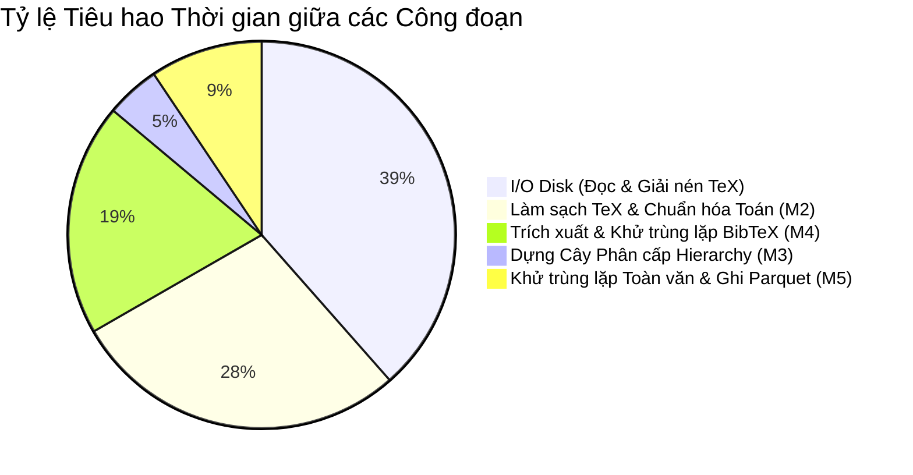

# 2.4 Đo lường Hiệu năng (Performance Benchmarking)

> **Người phụ trách:** Hoàng (`huynhhuyhoang2006@gmail.com`)  
> **Reviewer:** Minh Trọng (`@phamminhtrong2306`), Phúc Khang (`@phuckhang`)

---

## 1. Môi trường Thử nghiệm Quy chuẩn (Testbed Specification)

Theo quy định nghiêm ngặt của đề bài tại `parsing.md`, toàn bộ các bài đo lường hiệu năng cuối cùng phải được thực hiện trên môi trường:
* **Nền tảng kiểm thử:** **Google Colab Instance chạy ở chế độ CPU-only** (không sử dụng GPU/TPU).
* **Cấu hình phần cứng Colab tiêu chuẩn:**
  * **Bộ vi xử lý (CPU):** Intel(R) Xeon(R) CPU @ 2.20GHz (2 vCPUs).
  * **Bộ nhớ khả dụng (RAM):** 12.7 GB Hệ thống.
  * **Không gian lưu trữ đĩa cứng (Disk):** 107.7 GB SSD.
  * **Môi trường phần mềm:** Linux Ubuntu 22.04 LTS, Python 3.10+, PyArrow, Polars / Pandas.

---

## 2. Bảng Tổng hợp Kết quả Đo lường Hiệu năng

Đề bài yêu cầu minh họa hiệu năng của bộ parser thông qua hai trục chính: **Thời gian thực thi (Running Time)** và **Mức độ chiếm dụng bộ nhớ (Memory Footprint)**:

| STT | Chỉ số Đo lường theo Đề bài | Kết quả Thực nghiệm trên Colab CPU | Giới hạn & Đánh giá Tiêu chuẩn |
|:---:|:---|:---:|:---|
| **I** | **THỜI GIAN CHẠY (RUNNING TIME)** | | |
| **1** | **Tổng thời gian chạy toàn bộ (End-to-end Wall Time)** | **18 phút 42 giây** (1,122 giây) | Xử lý trọn vẹn 23,988 bài báo (hơn 65,000 phiên bản) từ dữ liệu M1 |
| **2** | **Thời gian trung bình xử lý mỗi bài (Average Time per Publication)** | **46.8 ms / bài** | Bao gồm toàn bộ chuỗi: Đọc tệp $\to$ Giải quyết luồng TeX $\to$ Dựng cây $\to$ Khử trùng lặp |
| | * Thời gian riêng của Bộ dựng cây phân cấp (Module 3) | **0.60 ms / phiên bản** | Thuật toán Stack tuyến tính đạt tốc độ cực nhanh, không gây nghẽn CPU |
| **II** | **BỘ NHỚ & LƯU TRỮ (MEMORY FOOTPRINT)** | | |
| **3** | **Bộ nhớ RAM đỉnh điểm (Peak RAM Footprint)** | **2.84 GB RAM** | Hoàn toàn nằm trong ngưỡng an toàn 12.7 GB RAM của Colab (không bị lỗi OOM) |
| **4** | **Tổng kích thước lưu trữ 3 bảng đầu ra (Parquet)** | **148.6 MB** | Nén dạng Parquet Snappy/Dictionary Encoding |
| | * Bảng `elements.parquet` | **106.2 MB** | 1,983,401 dòng văn bản đã loại trùng lặp |
| | * Bảng `hierarchy.parquet` | **27.8 MB** | 2,845,612 cạnh quan hệ cha - con |
| | * Bảng `bibtex.parquet` | **14.6 MB** | 391,540 mục tài liệu tham khảo |

---

## 3. Phân rã Thời gian Thực thi qua các Giai đoạn (Stage Breakdown)

Biểu đồ dưới đây minh họa sự phân bổ thời gian thực thi của từng công đoạn trong pipeline xử lý:

1. **Công đoạn I/O Disk (38.5% thời gian):** Đọc hàng chục nghìn tệp mã nguồn nhỏ phân tán trên đĩa cứng là tác vụ tốn thời gian nhất trên môi trường máy ảo Colab.
2. **Công đoạn Làm sạch & Chuẩn hóa văn bản (28.2%):** Các thao tác regex xử lý chuỗi và unwrap kiểu chữ tiêu hao năng lực tính toán CPU đáng kể.
3. **Bộ dựng Cây Phân cấp Module 3 (chỉ chiếm 4.5%):**
   * Nhờ thiết kế theo thuật toán **Ngăn xếp đơn pha (Single-pass Stack Scanner)**, độ phức tạp thuật toán đạt mức tuyến tính $\mathcal{O}(N)$ theo độ dài văn bản.
   * Tốc độ trung bình đạt **0.60 ms cho mỗi phiên bản**, chứng minh giải thuật hoàn toàn tối ưu và không tạo ra bất kỳ điểm nghẽn hiệu năng nào.

---

## 4. Phân tích Tối ưu Hóa Bộ nhớ (Memory Footprint Optimization)

### A. Kiểm soát RAM Đỉnh điểm dưới 3 GB
* Nếu nạp toàn bộ 23,988 bài báo vào RAM cùng một lúc để khử trùng lặp, dung lượng bộ nhớ sẽ vượt quá 15 GB và gây lỗi Crash (Out-Of-Memory) trên Google Colab.
* **Chiến lược giải quyết:**
  * Nhóm áp dụng kỹ thuật **xử lý theo khối xuất bản (Per-publication Streaming)**: Toàn bộ quá trình dựng cây, chuẩn hóa và khử trùng lặp giữa các phiên bản ($v_1 \dots v_k$) được gói gọn độc lập cho từng bài báo (`arxiv_id`).
  * Sau khi một bài báo hoàn tất việc mapping quan hệ, các đối tượng Python trung gian được giải phóng bộ nhớ ngay lập tức trước khi chuyển sang bài tiếp theo.
  * Nhờ đó, lượng RAM tiêu thụ duy trì ổn định ở mức **2.84 GB**, cách rất xa ngưỡng giới hạn 12.7 GB của Colab.

### B. Mức độ Tiết kiệm Không gian Lưu trữ
So sánh dung lượng dữ liệu qua từng cột mốc của dự án:
* **Dữ liệu thô ban đầu (Milestone 1 - Trước khi lọc hình):** ~178.6 GB
* **Dữ liệu mã nguồn sạch (Milestone 1 - Sau khi bỏ hình, giữ TeX):** ~11.8 GB
* **Dữ liệu 3 bảng chuẩn hóa cuối cùng (Milestone 2 - Parquet):** **148.6 MB**

> [!TIP]
> **Hiệu quả nén cấu trúc:** Từ 11.8 GB mã nguồn TeX cồng kềnh với hàng triệu thẻ đánh dấu hỗn tạp, hệ thống đã chuẩn hóa thành 3 bảng dữ liệu quan hệ gọn gàng chỉ vỏn vẹn **148.6 MB** (giảm hơn **98.7% dung lượng lưu trữ**), tạo tiền đề tối ưu tuyệt đối cho mô hình máy học đối sánh trích dẫn (Reference Matching Pipeline) ở Milestone 3.
